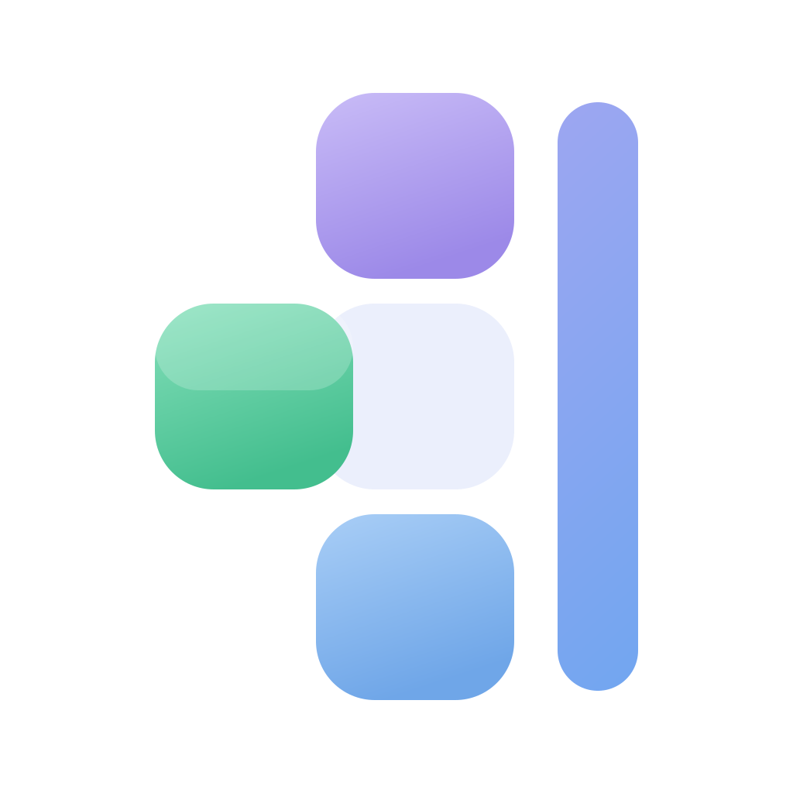
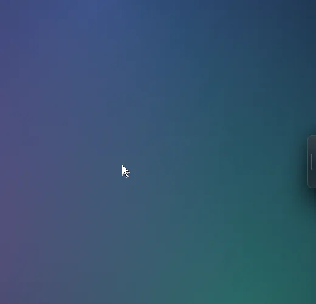
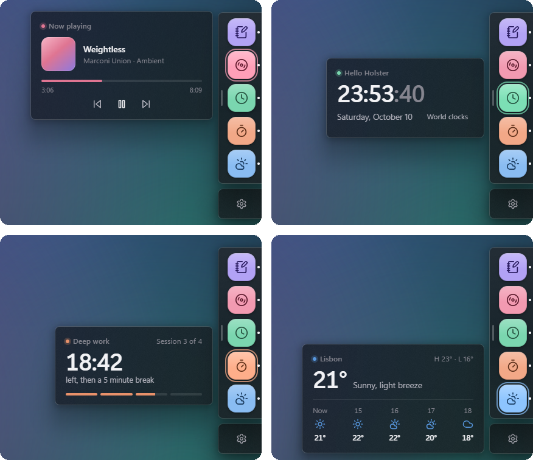

<p align="center">
  
</p>

<h1 align="center">Holster</h1>

<p align="center">
  <b>A dock on the edge of your screen, for your own apps.</b><br>
  A slim frosted tab that opens into a column of tiles. Rest on one and the app's live preview slides out.
</p>

<p align="center">
  
  
  
  <a href="LICENSE"></a>
</p>

<p align="center">
  <picture>
    <source media="(prefers-color-scheme: dark)" srcset="docs/images/demo-dark.webp">
    <source media="(prefers-color-scheme: light)" srcset="docs/images/demo-light.webp">
    
  </picture>
</p>

---

Holster is **only the frame**. Every app in it decides its own icon, its color, the preview that slides out next to its tile, and how it opens: as its own side panel or as a regular window. Apps register themselves with a small JSON manifest, so anything you build (a script, a Rust tool, a web app on localhost) can live in the dock.

> [!NOTE]
> Holster is **Windows 11 only**. It is drawn with native Windows materials (acrylic, rounded corners, DWM-paced animation) and Win32 hooks, so there is no macOS or Linux build.

## Highlights

- **Out of the way until you want it.** A 14 px frosted tab on the right edge. Rest on it, click it, or press `Ctrl+Shift+H`.
- **Previews without opening anything.** Hover a tile and the app's preview slides out like a drawer. Previews can be pages on disk, so they show even when the app isn't running. Moving between tiles crossfades, never reloads.
- **Never steals your focus.** The dock opens on hover without taking the keyboard from what you're typing in. Only a click outside, `Esc`, the shortcut, or opening an app closes it, so a stray mouse move can't make it vanish.
- **Apps take the edge.** When an app opens its own side panel, the dock folds into the edge and the tab steps aside until the panel closes.
- **Ambient signals.** An app can say "something happened" and the tab glows in its color, or its tile pulses while the dock is open.
- **Game mode.** While a fullscreen app is in front, the tab tucks away and never takes focus. Glows wait until you're back.
- **Native all the way down.** Real acrylic, Windows 11 corners and hit-testing on every frame, spring animations paced by the compositor, light and dark themes.
- **Tiny and local.** One small Rust process. Its API listens on loopback only, and everything it stores is plain JSON in `%APPDATA%\Holster`.

## Previews

<p align="center">
  <picture>
    <source media="(prefers-color-scheme: dark)" srcset="docs/images/previews-dark.png">
    <source media="(prefers-color-scheme: light)" srcset="docs/images/previews-light.png">
    
  </picture>
</p>

A preview is just a web page that your app ships: transparent, theme-aware, sized to its content. Holster draws the card around it (material, hairline, shadow), slides it out from behind the dock, tells the page the theme and whether your app is running, and lets it resize itself at runtime. These are demo apps; `Hello Holster`, the clock, is the [example app](examples/hello-holster) in this repo.

## Install

There are no prebuilt releases yet, so build it from source. It takes a few minutes the first time.

1. Install the prerequisites: [Rust](https://rustup.rs) (stable, MSVC), [Node.js](https://nodejs.org) 20+, [pnpm](https://pnpm.io), and the Visual Studio C++ Build Tools. WebView2 already ships with Windows 11.
2. Build the installer:

   ```sh
   git clone https://github.com/ManyGlue0/Holster.git
   cd Holster
   pnpm install
   pnpm tauri build
   ```

3. Run `target\release\bundle\nsis\Holster_0.1.0_x64-setup.exe`. It installs for the current user (no admin rights) and starts with Windows by default.

The installer isn't code-signed, so Windows SmartScreen may warn you the first time ("More info", then "Run anyway").

## Using it


- **Open the dock**: rest the cursor on the tab for a moment, click it, or press `Ctrl+Shift+H`. The shortcut can be changed in Settings, which also tells you if another app already holds it.
- **Close it**: click anywhere outside, click the dock's grip, press `Esc` or the shortcut again, or open an app.
- **Preview an app**: rest on its tile. Move straight into the preview to use it; diagonal paths over other tiles are fine.
- **Open an app**: click its tile. Apps that aren't running are started, with a spinner tracing the tile until they answer.
- **More than five apps**: scroll the column with the wheel. It moves one tile at a time, with soft fades where more apps are hidden.
- **Move it**: drag the tab, or the dock's grip, up or down.
- **Settings**: the gear card below the dock, or the tray icon. Reorder apps by dragging, hide them, remove them, or add a manifest by hand. Theme (System, Light, Dark), shortcut, launch at startup, hiding during fullscreen apps, and hover timing.

<br clear="right">

## Put your app in the dock

An app joins Holster by writing a manifest to `%APPDATA%\Holster\apps\<id>.json` when it starts. Holster watches that folder live and validates every file. A broken manifest never breaks the dock: it shows up in Settings with the exact error.

```json
{
  "schema": 1,
  "id": "notes",
  "name": "Notes",
  "icon": { "lucide": "notebook-pen" },
  "color": "lavender",
  "health": "http://127.0.0.1:47321/holster/health",
  "preview": { "path": "C:\\Path\\To\\Notes\\holster-preview\\index.html", "width": 320, "height": 260 },
  "open": { "mode": "panel", "url": "http://127.0.0.1:47321/holster/open" },
  "launch": { "exe": "C:\\Path\\To\\Notes.exe", "args": [] }
}
```

- **Icon**: any [Lucide](https://lucide.dev/icons) icon, drawn on a tile in your color, or your own image at a share of the tile (`"size": "80%"` by default).
- **Color**: a palette name (`mint`, `peach`, `lavender`, `sky`, `butter`, `rose`, `sage`, `lilac`, `apricot`, `mist`) or any hex color.
- **Preview**: a page on disk (served by Holster, so it works while your app is closed), a live page from your running app, or both.
- **Open**: `panel` (Holster calls your `open.url` and you slide out your own panel) or `window` (Holster starts or focuses your exe).
- Every URL must be `http://127.0.0.1`. Holster talks to nothing else.

**The full contract is in one file: [`skill/holster-app/SKILL.md`](skill/holster-app/SKILL.md).** It covers registration, preview pages, opening, signals, security, a minimal server, the recommended stack, and the design language with exact values (tokens, palette, material, geometry, springs). It is written as an [Agent Skill](https://agentskills.io), so you can hand it to a coding agent and ask it to make your app Holster-ready, or simply read it.

Install it into your agent (Claude Code, Codex, Cursor and [many more](https://github.com/vercel-labs/skills#supported-agents)) with one command:

```sh
npx skills add https://github.com/ManyGlue0/Holster/skill/holster-app
```

Then ask your agent something like *"make this app show up in Holster"*.

[`examples/hello-holster`](examples/hello-holster) is the smallest complete app: a live clock preview on disk (with a runtime resize), `window` open mode, and an activity signal when you press `Space`. Run it with `pnpm hello` while Holster is running.

### Local API

Holster listens on a random loopback port and writes it to `%APPDATA%\Holster\holster.json` (`version`, `port`, `pid`, `api`) while it runs.

| | |
|---|---|
| `GET /status` | `{ "running": true, "version": "0.1.0" }` |
| `POST /apps/{id}/signal` | body `{ "kind": "activity" }`: the tab glows in the app's color |
| `POST /apps/{id}/reload` | re-reads the manifests and answers with that app's validation result |
| `GET /apps/{id}/preview/{file}` | serves an app's on-disk preview folder, so previews work while the app is closed |

Requests must name the loopback host (a DNS-rebinding guard), and browser requests must come from loopback origins. Sending a signal from PowerShell:

```powershell
$holster = Get-Content "$env:APPDATA\Holster\holster.json" | ConvertFrom-Json
Invoke-RestMethod -Method Post "$($holster.api)/apps/notes/signal" -ContentType application/json -Body '{"kind":"activity"}'
```

## Your data

Everything lives in `%APPDATA%\Holster\`: `settings.json` (theme, shortcut, dock order, hidden apps, tab position, hover timing), `apps\` (one manifest per app) and `holster.json` (only while Holster runs). Dock order and visibility belong to you and live in settings, never in the manifests, so an app rewriting its manifest can't undo your arrangement.

## How it's drawn

Every surface is a frameless, always-on-top window whose **bounds are the visible shape**, so the real acrylic blur, the Windows 11 rounded corners and hit-testing follow every frame, and nothing transparent can swallow your clicks. There are three: the **main** window (the tab, which morphs into the dock or into the settings panel), the **settings card** below the dock, and the **preview card** to its left. Shape changes animate the native window rect with per-edge springs on a thread paced by `DwmFlush`; the UI lays out at its final size and is revealed, not reflowed.

The dock opens on hover, so it never takes keyboard focus. While it's open, low-level mouse and keyboard hooks (installed only for that time) notice a click outside Holster and the `Esc` key. The settings panel does take focus, and closes when you click away.

Previews are sandboxed iframes over Holster's material. Every preview stays loaded while the dock is open (and for 20 seconds after), so moving between tiles is a crossfade, never a reload. The settings and preview cards stay shown but parked off screen when unused (a freshly shown window draws a hollow frame for its first frames), and they carry the veil in their native material, so edges the webview hasn't repainted yet never flicker.

## Development

```sh
pnpm install
pnpm tauri dev        # Vite + the app, with hot reload for the UI
pnpm hello            # the example app (registers itself with Holster)
pnpm tauri build      # installer at target/release/bundle/nsis/
cargo test -p holster # backend unit tests
```

To try things without touching your real setup, point `APPDATA` at a sandbox folder before starting Holster and the example, and run dev under its own identifier so it doesn't meet an installed copy: `pnpm tauri dev --config dev-config.json` with `{ "identifier": "app.holster.dev" }` in that file. To inspect the UI, set `WEBVIEW2_ADDITIONAL_BROWSER_ARGUMENTS=--remote-debugging-port=9333` and open `http://127.0.0.1:9333`.

`pnpm icons` regenerates the Lucide data (`src/lib/lucide-nodes.json` for rendering, `src-tauri/src/lucide-names.txt` for manifest validation). `pnpm app-icon` renders every app icon size from [`src-tauri/icons/holster-icon.svg`](src-tauri/icons/holster-icon.svg) with headless Edge.

```
src-tauri/src/
  lib.rs         app setup: windows, plugins, tray, hotkey, API, watchers
  shell.rs       the three windows: spring-animated native bounds, geometry, acrylic, focus
  apps.rs        manifests: parsing, validation, dock order, folder watcher
  health.rs      running / not running, polled only while something is open
  process.rs     launching apps, finding and focusing their windows
  api.rs         the loopback API and holster.json
  hooks.rs       click-away and Escape for the dock without taking focus
  fullscreen.rs  game mode
  settings.rs    settings.json
src/             React + TypeScript UI (Framer Motion, dnd-kit, Lucide), one bundle for all windows
skill/holster-app/SKILL.md   the app contract and design language
examples/hello-holster/      the example app and test fixture
docs/images/                 README screenshots
```

## License

[MIT](LICENSE)
